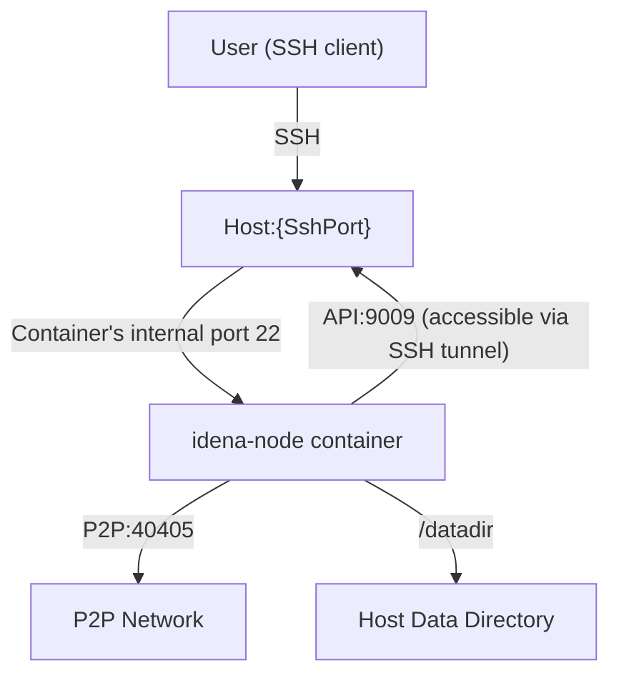

# Idena Node Docker Image

[](https://hub.docker.com/repository/docker/rinzlerfr/idena-node)
[](https://hub.docker.com/repository/docker/rinzlerfr/idena-node)
[](https://hub.docker.com/repository/docker/rinzlerfr/idena-node)
[](https://github.com/Rinzler78/docker.idena-node/stargazers)
[](https://github.com/Rinzler78/docker.idena-node/network/members)
[](https://github.com/Rinzler78/docker.idena-node/issues)
[](https://github.com/Rinzler78/docker.idena-node/commits/master)
[](https://github.com/Rinzler78/docker.idena-node/issues)
[](https://opensource.org/licenses/MIT)

---

## Overview

This repository provides a ready-to-use Docker image to run an Idena node easily and securely, with SSH access and persistent data storage.
Running an Idena node allows you to actively participate in the Idena network, validate transactions, and contribute to decentralization. Running your node via Docker simplifies installation, dependency management, and ensures an isolated and reproducible environment.
For more information about the Idena project, visit [idena.io](https://idena.io/).

---

## Table of Contents

- [Features](#features)
- [Architecture](#architecture)
- [Prerequisites](#prerequisites)
- [Quick Start](#quick-start)
- [Configuration](#configuration)
- [Usage](#usage)
- [Update Instructions](#update-instructions)
- [Synology NAS Deployment](#synology-nas-deployment)
- [Security Considerations](#security-considerations)
- [FAQ / Troubleshooting](#faq--troubleshooting)
- [Support](#support)
- [Contributing](#contributing)
- [License](#license)

---

## Features

- Simple deployment of an Idena node via Docker
- SSH access to the container
- Automatic update of the Idena node binary
- Persistent data storage via Docker volumes
- Easy migration from existing nodes
- Public image available on Docker Hub

---

## Architecture



---

## Prerequisites

- Docker (version 20+ recommended)
- Supported OS: Linux, macOS, Windows (with Docker)
- At least 2GB RAM and 2GB free disk space
- Internet connection

---

## Quick Start

First, create a directory on your host to persist node data and, if you have one, copy your `api.key` into it:
```sh
mkdir -p ~/MyDockers/idena-node/datadir
# If you have an existing API key:
# cp /path/to/your/api.key ~/MyDockers/idena-node/datadir/api.key
```

Then, run the container:
```sh
SSH_PORT=60022
P2P_PORT=40405
API_PORT=9999

docker run -d \
  --restart unless-stopped \
  -p ${SSH_PORT}:22 \
  -p ${P2P_PORT}:40405 \
  -p ${API_PORT}:9009 \
  -v ~/MyDockers/idena-node/datadir:/datadir \
  -e IDENA_USER_ACCOUNT_NAME=idenaUser \
  -e IDENA_USER_ACCOUNT_PASS=idenaUserPassword \
  --name idena-node rinzlerfr/idena-node
```
Options explained:
- `-d`: Runs the container in the background (detached mode).
- `--restart unless-stopped`: Automatically restarts the container unless it has been explicitly stopped (e.g., by `docker stop idena-node`).

> **Note:**
> The SSH port mapping (`-p ${SSH_PORT}:22`) is required if you want to connect to your node via SSH, for example to use port forwarding with the command:
> ```sh
> ssh -L 9999:localhost:9009 idenaUser@<host_ip> -p ${SSH_PORT}
> ```
> Here, `${SSH_PORT}` is just an example: you can replace it with any free port of your choice, as long as you use the same port number in both the `docker run` and `ssh` commands. This is necessary to allow the Idena desktop application to connect to your remote node as if it were local (the application will connect to `http://localhost:9999`).
>
> The `-p ${API_PORT}:9009` mapping in the `docker run` command exposes the node's API port on a configurable host port. If access is *exclusively* via the SSH tunnel (as described above), this direct API port mapping is not strictly necessary for this specific access method, as the tunnel handles the connection to the container's internal port `9009`. The architecture diagram illustrates API access via the container's internal port `9009`, typically reached through the SSH tunnel.

**Replace:**
- `${SSH_PORT}`, `${P2P_PORT}`, and `${API_PORT}` with your desired host ports
- `~/MyDockers/idena-node/datadir` with your data directory path
- `idenaUser` and `idenaUserPassword` with your SSH credentials

---

## Configuration

| Variable                   | Description                        | Required | Example           |
|----------------------------|------------------------------------|----------|-------------------|
| IDENA_USER_ACCOUNT_NAME    | SSH user account name              | Yes      | idenaUser         |
| IDENA_USER_ACCOUNT_PASS    | SSH user account password          | Yes      | idenaUserPassword |

**Host ports:**
- SSH host port: configurable via `-p <ssh_port>:22` in `docker run` or `IDENA_SSH_HOST_PORT` in Compose.
- P2P host port: configurable via `-p <p2p_port>:40405` in `docker run` or `IDENA_P2P_HOST_PORT` in Compose.
- API host port: configurable via `-p <api_port>:9009` in `docker run` or `IDENA_API_HOST_PORT` in Compose.

**Data directory:**
Create a directory on your host to persist node data (if not already done in Quick Start) and copy your `api.key` into it:

```sh
mkdir -p ~/MyDockers/idena-node/datadir
cp /path/to/your/api.key ~/MyDockers/idena-node/datadir/api.key
```
Your `api.key` is usually found in the `datadir` directory of your existing Idena installation, or is generated by the Idena client when first setting up a local node. If you don't have one, the node will generate one on its first startup, but you will need to retrieve it from the container (e.g., via SSH) to use it with the desktop application.

---

## Usage

### Build the image (optional)

If you want to build the image locally:

```sh
docker build -t idena-node .
```

### Validate the image and configuration

The repository includes dedicated validation scripts:

```sh
./tests/compose_config_test.sh
./tests/image_contract_test.sh
./tests/run_all.sh
```

- `compose_config_test.sh` checks default and overridden Compose host ports.
- `image_contract_test.sh` checks image metadata, runtime health, and `/tools` script behavior.
- `run_all.sh` runs the full validation suite, including `quick_test.sh`.

### Use Docker Compose (optional)

If you prefer Compose, a ready-to-use example is provided in `docker-compose.yml`:

```sh
export IDENA_SSH_HOST_PORT=60022
export IDENA_P2P_HOST_PORT=40405
export IDENA_API_HOST_PORT=9999
docker compose up -d
```

By default, the Compose setup stores `/datadir` in the named Docker volume `idena-node-data`.
This avoids creating a host bind mount unless you explicitly choose a different deployment pattern.

### Run the container

See [Quick Start](#quick-start).

### Connect to the node from Idena Desktop App

To access your remote node API securely from your local Idena desktop app, use SSH port forwarding:

```sh
ssh -L 9999:localhost:9009 idenaUser@<host_ip> -p 60022
```
(If the Idena Desktop application is running on the same machine as the Docker container, you can use `localhost` as `<host_ip>`.)

Then, in the Idena app, set the node address to:
`http://localhost:9999`

---

## Update Instructions

1. Pull the latest image:
   ```sh
   docker pull rinzlerfr/idena-node
   ```
2. Stop and remove the existing container (data is preserved):
   ```sh
   docker stop idena-node
   docker rm idena-node
   ```
3. Run the container again with your previous command. (Make sure to use the exact same `-p`, `-v`, and `-e` parameters as during the initial launch to preserve your configuration and data.)

---

## Synology NAS Deployment

1. **Install Docker** via the Package Center.
2. **Search for `rinzlerfr/idena-node`** in the Docker registry and download it.
3. **Create the data directory** (e.g., `docker/idena-node/datadir`).
4. **Copy your `api.key`** into the data directory.
5. **(Optional) Migrate existing node data** by copying all files from your old datadir.
6. **Configure and start the container** via the Docker GUI:
   - Set up volumes, ports, and environment variables as described above.

---

## Security Considerations
- **SSH Password:** It is strongly recommended to use a strong and unique SSH password (`IDENA_USER_ACCOUNT_PASS`).
- **SSH Port Exposure:** Carefully consider the implications of exposing your container's SSH port to the internet. If possible, limit access to this port via firewall rules, allowing only trusted IP addresses.
- **API Key:** Protect your `api.key`. Do not share it publicly.

---

## FAQ / Troubleshooting

### Port already in use

Make sure the ports (SSH port like 60022, Idena P2P 40405, Idena API if directly exposed like 9999) are not used by another service on your host.

### Permission denied on /datadir

Ensure the Docker user has read/write permissions on the mapped directory. You can try to fix permissions with `sudo chown -R $(id -u):$(id -g) ~/MyDockers/idena-node/datadir` (adapt the path if necessary and ensure the user running this command is the one who created the directory or has sudo rights) or ensure the user running Docker has the rights. On Windows, check Docker Desktop's drive sharing settings.

### Cannot SSH into the container

Check SSH port mapping, username, password, and host IP. Ensure the SSH service is running in the container (it should be by default).

### Container does not restart

Use `--restart unless-stopped` in your `docker run` command.

### How to check container logs?
Use the command `docker logs idena-node` to see the node's output.

**For other issues, open an issue on GitHub or see [Support](#support).**

---

## Support

- Open an issue on [GitHub](https://github.com/Rinzler78/docker.idena-node/issues)
- Contact: @Rinzler78 (maintainer)

If you find this project useful, donations are welcome:
`0x3fc4e0d8dcc6d767eb5381abe89f52cad874a8e5`

---

## Contributing

See [CONTRIBUTING.md](CONTRIBUTING.md) for local build, test, and pull request guidelines.

Contributions are welcome!
Please open an issue or a pull request on [GitHub](https://github.com/Rinzler78/docker.idena-node).

---

## License

MIT — see [LICENSE](LICENSE) for details.

---
